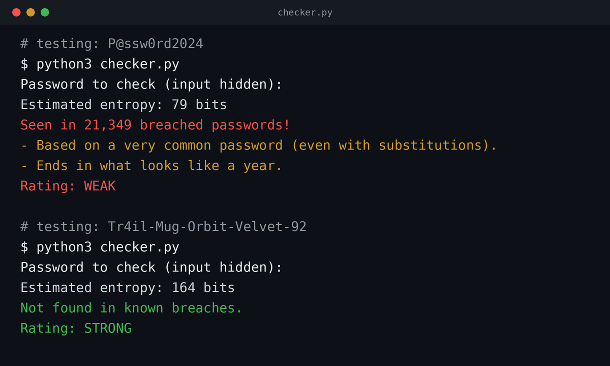
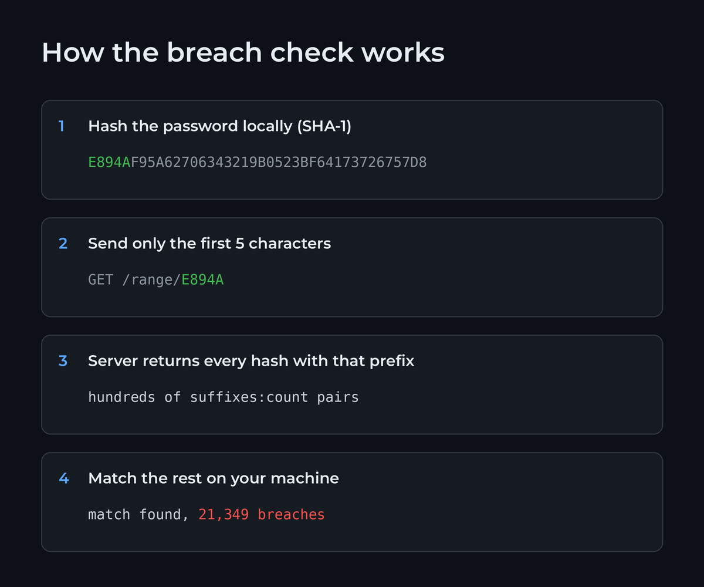

# Password Strength Checker

A small Python tool that rates a password three ways:

1. **Entropy estimate**: bits of randomness, based on length and character set.
2. **Pattern detection**: flags what attackers try first, like common passwords with letter swaps (`P@ssw0rd`), keyboard or number sequences, repeated characters, and a year on the end.
3. **Breach check**: looks the password up in [Have I Been Pwned](https://haveibeenpwned.com/Passwords) using k-anonymity. The password is hashed with SHA-1 locally, and only the first 5 characters of the hash are sent, so the password itself never leaves your machine.



## How the breach check works



## Usage

Requires Python 3.10+. No third-party packages.

```bash
python3 checker.py
```

Input is hidden while you type.

## Design

- `EntropyEstimator`: estimates entropy from length and character classes
- `PatternDetector`: flags common, predictable patterns
- `BreachChecker`: queries the Have I Been Pwned range API with k-anonymity
- `PasswordStrengthChecker`: combines the three into a `StrengthReport` with a `Rating` (WEAK, FAIR, or STRONG)

Each component is injected, so it can be swapped or mocked in tests.

## Takeaway

Entropy formulas assume randomness, and people aren't random. `P@ssw0rd2024` scores about 79 bits but appears in over 21,000 breaches.

## Disclaimer

For learning purposes. Don't type real passwords into tools you haven't read the code of, including this one.
